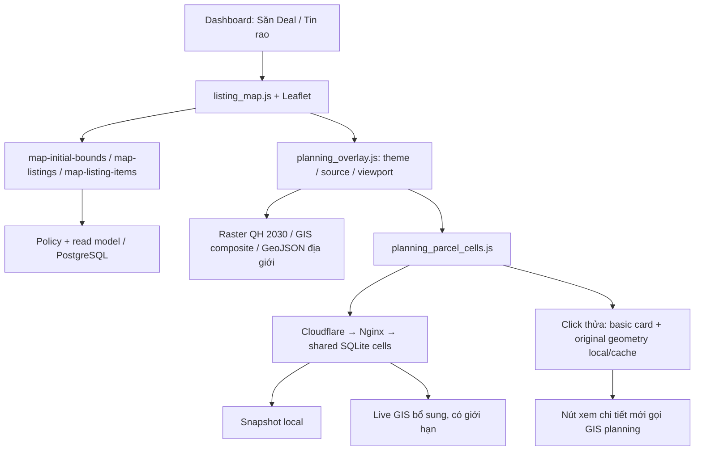

# Maps — tài liệu vào việc cho AI Agent

Đối chiếu code ngày **2026-11-01**, baseline đã commit/deploy:
`d885521c1e5773fe8f824c986147665099e1303c`. Đây là điểm bắt đầu cho mọi task Maps;
đọc phần liên quan rồi theo link chuyên đề, không cần đọc toàn bộ lịch sử chat.
Baseline là mốc bàn giao, không phải khẳng định VPS sẽ luôn giữ SHA này.

## 1. Bắt đầu trong 5 phút

1. Đọc `../AGENTS.md`, chạy `git status --short --branch` và `git log -3 --oneline`.
2. Nếu có `graphify-out/graph.json`, dùng `graphify query`/`path`/`explain`, sau đó
   đối chiếu code. Graph có thể chứa cả file local chưa commit và có thể cũ.
3. Phân biệt code `HEAD`, thay đổi local, assets runtime và trạng thái production.
   Dùng `git diff -- <file>` / `git show HEAD:<file>` khi cần xác định baseline.
4. Chọn module theo bảng dưới; đọc đúng tài liệu chuyên đề ở phần 12.
5. Khi sửa hành vi, cập nhật test, version asset trong `templates/index.html` và
   tài liệu hiện hành tương ứng. Tài liệu nguồn có các lần thử lịch sử; không lấy
   default hay số giới hạn ở một đoạn lịch sử làm hành vi hiện tại.

**Ranh thửa các tỉnh còn thiếu đang tạm dừng theo yêu cầu người dùng.** Giữ nguồn
đã có hoạt động; không tự khởi động lại nghiên cứu/crawl địa chính toàn quốc.
QH SDĐ 2030 toàn quốc và địa giới toàn quốc không đồng nghĩa ranh thửa toàn quốc.

## 2. Bản đồ các module

| Trách nhiệm | Điểm vào chính |
| --- | --- |
| Workspace, mở/đóng, sidebar, history, marker và listing rail | `static/js/main/listing_map.js`, `static/css/main/listing_map.css`, `templates/partials/listing_map_workspace.html` |
| Listing summary/items, policy, cache key | `services/listing_map.py`, `services/listing_map_viewport.py`, các route Maps trong `app.py` |
| Tọa độ tin rao, registry, chỉnh vị trí của admin | `services/listing_location_*`, `services/listing_map_overrides.py`, `config/listing_map*` |
| Điều phối theme/source/opacity/viewport và popover | `static/js/main/planning_overlay.js`, `static/css/main/planning_overlay.css`, `planning_mobile.css` |
| Khu vực theo địa danh cũ, kiểm tra lớp có phủ tỉnh | `static/js/main/planning_area.js`, `config/planning_regions.py`, `config/planning_landuse_areas.json` |
| Đăng ký live GIS, catalogue, rate limit, HTTP cache policy | `services/planning_live.py`, `app.py:add_response_headers` |
| Native GIS PNG, composite và cache ảnh | `services/planning_tiles.py`, `static/js/main/planning_native_tiles.js`, `config/planning_gis_metadata/` |
| Snapshot overlay bất biến và kiểm hash | `services/planning_assets.py`, `config/planning_release.json`, `config/planning_live_release.json` |
| Catalogue ranh local, tra tờ/thửa, adapter GIS mở rộng | `services/planning_parcels.py`, `planning_parcel_catalog.py`, `planning_live_parcels.py` |
| Ô ranh dùng chung và hình học gốc | `services/planning_parcel_tiles.py`, `static/js/main/planning_parcel_cells.js` |
| UI chọn thửa, popup cơ bản/chi tiết và tra cứu | `static/js/main/planning_parcels.js`, `planning_parcel_tools.js`, `static/css/main/planning_parcels.css` |
| Tọa độ/góc ranh và OCR từ ảnh | `services/planning_coordinates.py`, `planning_corner_ocr.py`, `static/js/main/planning_corner_scan.js` |
| Vẽ đo ranh, diện tích và ký hiệu đất | `static/js/main/planning_measure.js`, `planning_legend.js`, `static/data/planning_symbols.json` |
| Địa giới cũ/mới và giao thông | `static/js/main/planning_administrative*.js`, `planning_transport.js`, các config cùng tên |
| Tên đường vệ tinh | `static/js/main/satellite_osm_labels.js`, `services/map_label_tiles.py`, `static/vendor/protomaps-leaflet-*` |
| Nginx/Cloudflare và đo tải Maps | `deployment/ubuntu24/nginx-radar-maps-*`, `deployment/cloudflare/maps-*.json`, `scripts/load/radar_maps_cache_load.js` |

Các tên file không kèm thư mục trong một ô giữ cùng thư mục với file trước nó.
Các route hiện còn đăng ký trong `app.py` hoặc hàm `install*`; không tự tạo một
kiến trúc router song song chỉ để sửa một lỗi Maps.

## 3. Luồng tổng thể



Đây là các luồng riêng: **tin rao**, **ảnh quy hoạch**, **ranh thửa**, **tra cứu**,
**địa giới**, **bản đồ nền/tên đường**. Một luồng lỗi không được xóa kết quả tốt
của luồng khác hoặc bị diễn giải thành “không có quy hoạch”. Maps nằm trong
dashboard; không có route công khai `/maps` ở baseline này.

## 4. Hành vi hiện hành phải giữ

- Mở Maps thường: fullscreen/focus, nền **vệ tinh**, theme **QH Phân khu 50%**.
  Entry chọn theme cụ thể giữ theme đó; entry địa giới dùng nền đường phố.
- Mở quy hoạch từ Công cụ/hub: ẩn tin đăng. Maps thường vẫn hiện tin đăng.
  Nút Ẩn/Hiện tin đăng độc lập với fullscreen; khi ẩn, dừng request listings.
- Opacity độc lập theo theme và giữ khi tắt/bật trong phiên: phân khu 50%,
  SDĐ 2030 65%, giao thông/địa giới 100%, các theme còn lại 35%.
- Khu vực quy hoạch dùng **tỉnh/quận/huyện cũ**; mặc định bộ chọn khu vực là
  Bình Dương / Thủ Dầu Một, nhưng vùng mở Maps ưu tiên bộ lọc/entry cụ thể.
  Không ép người đang lọc Tân An về một tỉnh khác hoặc toàn tỉnh.
- Chỉ hiện loại quy hoạch đã có cho tỉnh được chọn. Giữ lớp TP.HCM mới khi
  nó thực sự bao phủ Bình Dương/BRVT; không suy độ phủ chỉ từ bbox giao nhau.
  Ranh có thể có độc lập với các theme quy hoạch. Panning không tự đổi tỉnh
  đang chọn cho raster 2030; các nguồn khác vẫn load theo viewport/coverage.
- Toolbar, summary, dock và popup thửa căn theo **canvas map**, loại phần
  sidebar/rail ra khỏi phép căn giữa. Dock có nút riêng, không nền trắng bao ngoài.
- Click ngoài Bộ lọc/Khu vực/Tờ-thửa/Lớp bản đồ đóng panel; giữ thao tác bàn phím.
  Mobile có toolbar/dock gọn, dock sát đáy và không có nút thoát focus/fullscreen.
- ResizeObserver gọi cập nhật kích thước Leaflet khi sidebar/rail đổi kích thước.
  Không dùng refit làm mất vị trí đang xem chỉ để sửa ô lưới nền.
- Marker tin rao phải nhận click trước ranh. Nhóm nhiều tin mở rail bên phải
  trên desktop hoặc sheet mobile. Đóng modal tin rao trở lại cùng Maps/viewport.
- Loading dùng task key riêng, qua sự kiện `planning:busy`; task kết thúc/lỗi/hủy
  phải clear key, không để một lớp giữ spinner của cả map vô hạn.
- Vị trí của tôi chỉ xin quyền sau click. Cần HTTPS và Permissions-Policy
  `geolocation=(self)` ở **cả Flask và Nginx**; app không thể tự reset quyền đã bị từ chối.

Giá trị reset trong `close()` không nhất thiết là default lúc mở; kiểm `open()`
và `defaultBaseLayer()` trước khi thay đổi default.

## 5. Tin rao: lọc trước, kéo rồi mới mở rộng địa lý

`/api/map-initial-bounds` lấy vùng mở từ địa giới tham khảo, không quét toàn bộ
tin rao hay gọi GIS nguồn để xác định viewport.

`/api/map-listings` trả summary marker và recent cards; `/api/map-listing-items`
trả chi tiết nhóm. Không gọi feed toàn cục `/api/listings` để dựng rail trên Maps.

| Thao tác | Scope tin rao |
| --- | --- |
| Mở map, zoom, resize, chọn thửa, di chuyển bằng chương trình | `scope=filtered`: giữ filter hiện tại, kết hợp bbox |
| Người dùng thực sự `dragstart` | `scope=viewport`: bỏ city/ward, giữ thời gian, giá, diện tích, loại hình và mọi tiêu chí ngoài địa lý được phép |
| Đổi bộ lọc / Về vùng đã lọc | Quay lại filtered, hủy request cũ, frame theo vùng lọc mới |

Summary/recent/group detail phải dùng cùng snapshot scope. Debounce sau moveend
350 ms; abort + sequence guard cùng tồn tại. Response cũ không được refit hoặc
ghi đè filter mới. Bbox WGS84 hữu hạn, round outward bốn số lẻ cho cache key;
ngoài vùng hỗ trợ trả rỗng, không trả tin từ vùng cũ. Tối đa 1.000 vị trí nhóm,
20 recent cards ban đầu, 50 items/trang nhóm; hiển thị gợi ý zoom khi bị cap.

Giữ tier/source/redaction và `actionable_signal_sql` policy; khi bật signal read
model, Signals Maps dùng `signal_card_read_model` và version `signals`, không
dựng latest-valuation CTE lại lúc click. Cache listing có tier/mode/version riêng;
không gộp nó vào cache public geometry. Không công khai URL gốc/điện thoại cho
guest/Free/VIP. Các điều kiện địa lý áp dụng sau manual location override.

## 6. Lớp quy hoạch: cấu hình, nguồn và viewport

Theme IDs: `partition`, `urban_general`, `detailed`, `land_use_2030`,
`urban_vision_100`, `transport`, `administrative`, `administrative_legacy`.

- `planning_overlay.js` điều phối, kiểm manifest/catalogue, bật nguồn GIS hoặc
  bản vẽ/PDF đã chuẩn bị. Thêm nguồn phải có config, provenance/audit, descriptor
  hợp lệ và test; không chỉ thêm một URL vào UI hoặc nới allowlist thành wildcard.
- `config/planning_landuse_2030.json`, `planning_landuse_2030_audit.json` và
  `planning_landuse_areas.json` giữ source 63 tỉnh cũ và vùng điều hướng. Chỉ
  provider thuộc tỉnh chọn mới eligible; shared provider không bật hai tỉnh cùng lúc.
- Không tải tất cả tỉnh/phường. Dùng viewport, native min/max zoom và coverage
  windows; không có pyramid thấp thì yêu cầu zoom gần, không fan-out hàng trăm ô.
- Bình Phước có pyramid tổng quan offline zoom0–14 từ chính nguồn tổng zoom15,
  giữ lớp khi zoom xa. Xem `planning_sources/national-partition.md` và
  `config/planning_overviews.json`; artifact phải upload/hash-check trước bật.
  Không ghép lại QH khác vào phân khu:400 sheet lẻ đã gỡ theo yêu cầu mới.
- GIS phân khu/chung/chi tiết có primary + supplement. Native ArcGIS dùng
  `/tile/{z}/{y}/{x}`; Leaflet/gateway dùng `{z}/{x}/{y}`. Giữ template nguyên dạng
  đã kiểm; không tự đảo trục hoặc xem bounds lat/lon như GeoJSON lon/lat.
- Composite supplement trước, primary trên, áp opacity **một lần**. Không trộn
  ảnh phân khu/SDĐ vào QH chung để che vùng nguồn trống. Không mặc định mọi QH
  chung đều đúng tỷ lệ 1/10.000 hoặc có hiệu lực pháp lý hiện hành.
- Queue native chia sẻ tối đa bốn tile đang tải; timeout tính từ lúc thực sự chạy.
  LRU tối đa 64 canvas 256px, khoảng 16 MiB pixels, TTL ba phút. Key có nguồn và
  z/x/y. Error/cancel không đi vào cache; off/on reuse composite thành công.
- Production đã bật gateway-first sau Nginx offload. Public fetch dùng
  `credentials:'omit'`; fetch ảnh thành Blob, vẽ lên canvas rồi revoke object URL.
  Layer remove/unload phải abort, xóa listener/timer và bỏ callback muộn.
- Raster `imageOverlay` phải remove layer trước khi gỡ listener; lỗi thứ tự
  remove/off từng làm sai transform khi tắt rồi bật và zoom lại.
- Bản vẽ đã georeference dùng bounds/manifest đã kiểm; giữ PDF/nguồn/legend.
  Assets immutable có release ID từ hashes, verify khi worker khởi tạo, fail closed.
  Không ghi đè một folder release đang dùng bằng ảnh mới cùng tên.
- Source attribution và nhãn bản dự thảo phải giữ. Branding tham khảo hiện dùng
  footprint đã review trong `config/planning_reference_branding.json`, build bằng
  `python -m scripts.build_planning_branding`; không tự dò/xóa pixel dựa trên màu đất.
  Thay logo hiển thị không thay đổi nguồn hoặc biến dữ liệu thành dữ liệu chính chủ.

## 7. Ranh thửa: ô hiển thị khác hình học đo đạc

Snapshot Bình Dương là SQLite read-only, gắn manifest/hash; GIS mở rộng chỉ bổ sung
khi cần. Ranh tải khi zoom đủ gần (17+), không gửi cả catalogue vào browser.

| Thành phần | Cơ chế/giới hạn ở baseline |
| --- | --- |
| Ô cố định | Grid Web Mercator **z17**; URL có release/kind/x/y; snapshot và live riêng |
| Browser | Hai reads song song, tối đa 36 ô visible; LRU mục tiêu 32 ô / hard byte cap 8 MB; TTL ba phút |
| Vẽ | Giữ layer cũ còn thấy, thêm tối đa 75 features/frame; tối đa 4.000 ranh; deduplicate bằng ID |
| Shared server cache | SQLite WAL `parcel-cells-v1.sqlite`, 32 MB / 2.048 cells; gzip JSON ổn định |
| Cold work | Lease xuyên worker: hai snapshot + hai live riêng; lease hết hạn 300 giây; busy trả 503 + Retry-After |
| TTL | Snapshot 24 giờ; live năm phút; geometry gốc từ live giữ tối đa 15 phút, riêng 32 MB / 4.096 entries |
| Display | Simplify topology-preserving 0.000003°; giữ hình học thửa giao cell, không cắt thành các cạnh giả theo cell |

32 ô là mục tiêu eviction của LRU; ô đang wanted được giữ ưu tiên, vì thế không
được diễn giải nó là hard cap số ô cache ở mọi thời điểm. Byte budget vẫn chặn
view quá nặng. Cell fixed grid lạnh có thể tải nhiều bytes hơn bbox chính xác;
lợi ích chính là chia sẻ cache qua nhiều người/pan, không phải mọi lần đầu đều nhẹ hơn.

Snapshot trả ngay, không chờ live GIS. Chỉ khi `needs_live` mới bổ sung live;
live lỗi không làm mất ranh snapshot. Hủy ô ngoài view, retry hữu hạn, cooldown
khi nguồn lỗi và thông báo dữ liệu thiếu/dense thay vì retry vô hạn.

Click một display feature mở basic card ngay; lấy hình học **gốc** từ snapshot
hoặc original cache cục bộ để highlight/đo. Endpoint original không đi GIS.
Nếu không có original, không đo bằng polygon đã simplify hoặc bịa số cạnh.
Chỉ nút “Xem đầy đủ thông tin quy hoạch chi tiết” mới gọi GIS planning lookup.
Đổi thửa/đóng popup/hủy Maps phải chặn response cũ và giữ dock hiển thị.

Ranh thường rất mờ (0.7px, opacity 0.28, không fill). Selection có highlight,
pin RadarBDS, diện tích nhỏ ở giữa và cạnh thửa. Cạnh chỉ hiện nếu đủ chỗ theo
screen length/rotated collision boxes; tránh vùng area/pin và tính lại khi zoom.
Diện tích sổ/nguồn có thể khác diện tích tính từ geometry; không đồng nhất hai số.
Chỉ đường chuyển điểm đã chọn khi người dùng theo link; Đo vẽ dùng đúng nguồn
geometry và ghi giới hạn nếu chỉ chọn một phần multipart.

**Độ phủ:** 91 đơn vị snapshot Bình Dương; 422 tham chiếu điều hướng cũ ở adapter
HCM gồm Bình Dương/HCM/Bà Rịa không chứng minh từng điểm có ranh. Địa giới không
phải ranh thửa. Pilot Đồng Nai/Bình Phước có file local riêng; xem phần 13 trước
khi gọi nó là chức năng đã release. Không chuyển ID nguồn giữa hai hệ GIS.

## 8. Contract API cần biết

| Endpoint | Vai trò / chính sách |
| --- | --- |
| `GET /api/planning/catalog.json` | Danh mục lớp; anonymous public 60 giây |
| `GET /api/planning/parcels/config.json` | Vùng tìm kiếm, cell templates; anonymous public 60 giây |
| `GET /api/planning/gis-tiles/<theme>/<z>/<x>/<y>.png` | Composite native chính xác theme; anonymous public một giờ |
| `GET /api/planning/parcel-cells/<release>/<snapshot\|live>/<x>/<y>.json` | Ô display, FeatureCollection; snapshot 24 giờ / live năm phút |
| `GET /api/planning/parcel-original/<release>/<id>.json` | Geometry gốc local/cache; private/no-store; không gọi GIS |
| `GET /api/planning/parcels/viewport.json` | Bbox flow cũ, rollback khi tắt cells; private/no-store |
| `GET /api/planning/parcels/search.json` | Tra đúng tờ/thửa và area; private/no-store |
| `GET /api/planning/parcels/coordinates.json` | Điểm WGS84/VN-2000; local-first rồi nguồn hiện có; private/no-store |
| `GET /api/planning/parcels/<id>/planning.json` | Chi tiết GIS theo yêu cầu; private/no-store |
| `POST /api/planning/parcels/corners.json` | Kiểm/đổi tọa độ polygon người dùng, không gọi GIS; private/no-store |
| `POST /api/planning/parcels/corners/scan.json?system=...` | OCR crop raw body, chỉ trả draft; private/no-store |
| `GET /api/map-labels/osm/<z>/<x>/<y>.mvt` | OSM gateway cố định; anonymous public bảy ngày |

Cell URL không chấp nhận query; version sai/out of bounds trả lỗi, không tái sử
dụng cell release khác. Public cell chỉ whitelist metadata cơ bản; không owner,
định danh cá nhân, số sổ, điện thoại hay kết quả chi tiết quy hoạch. Limits và
query/body schema cụ thể xem route/tests; đừng suy contract từ tên UI.
`/local-planning/` dành cho local pilot runner, không công khai lên production.

## 9. Tọa độ, góc ranh, OCR, đo vẽ và legend

- WGS84: latitude rồi longitude; GeoJSON vẫn `[longitude, latitude]`.
  VN-2000: X/northing rồi Y/easting, mét; bắt buộc chọn đúng CRS, không đoán theo tỉnh.
  Whitelist: `tm3-10545`/EPSG 9210, `tm3-10615`/9212, `tm3-10745`/5899,
  `utm48`/3405, `utm49`/3406. Không nhận PROJ/EPSG tùy ý; không dùng ballpark transform.
- Tra điểm phải nằm trong polygon thật, không lấy centroid/bbox gần nhất làm
  kết quả. Snapshot hit trả ngay; nhiều thửa giao điểm cho chọn. Không có nguồn
  thì di chuyển đến điểm kèm thông báo, không tạo ID thửa giả.
- Góc ranh: 3–100 điểm theo thứ tự, hai cột, có thể có số thứ tự và dòng đóng.
  Validate duplicate, self-intersection, finite, extent và CRS; body tối đa 16 KB.
  Output có provenance `user_corners`, không có cadastral ID, không tự tra GIS.
- Scan ảnh: browser crop/rotate, chỉ gửi crop JPEG cùng origin; không gửi ảnh
  sổ đầy đủ hay tên file gốc. Input local tối đa 12 MB/24 MP; crop server 4 MB/8 MP.
  Tesseract native + `eng`, một subprocess/worker, 20 giây, giới hạn output/OMP.
  Không lưu ảnh/temp file/OCR raw logs và không gọi OCR bên thứ ba.
  Chỉ lấy cặp số hợp lệ vào draft; người dùng phải kiểm rồi xác nhận. Không tự
  sửa chữ thành số, đoán trục hoặc tự vẽ/tra GIS sau OCR. Hủy phải invalidate kết quả muộn.
- Vẽ tay: click điểm, xem khoảng cách; đóng polygon để xem diện tích/perimeter,
  có xóa và giới hạn validity/100 điểm. Khi vẽ, marker/thửa nhường click; dừng
  phải trả double-click zoom và gỡ listener. Draft chỉ ở phiên browser.
  Đo tay dùng cầu bán kính 6.371.000 m; góc ranh server dùng WGS84 Geod. Đều là
  tham khảo, không chứng nhận địa chính; không âm thầm trộn hai phương pháp.
- Legend lazy-load, tách renderer GIS từng đồ án với bảng mã loại đất tham khảo;
  giữ màu/hatch/ảnh swatch và nguồn. Màu không biết thì ghi chưa biết.

## 10. Địa giới, giao thông và nhãn vệ tinh

Địa giới mới: 34 tỉnh; cũ: 63 tỉnh và tham chiếu huyện/xã cũ. Data/config riêng,
tải chi tiết theo viewport/zoom. Giữ polygon đã có thay vì dựng lại cả tỉnh mỗi
moveend; detail trả về chỉ thay đúng đơn vị. Ẩn nhãn xã thường trực, hover mới
hiện; nhãn cũ chỉ xã + huyện; click vùng zoom đến vùng. Attribution ở nguồn
inspector và credit bắt buộc vẫn giữ, không coi ẩn control Leaflet là quyền bỏ nguồn.

Giao thông tách metro/đường hiện trạng/đường dự kiến theo config và provenance.
Không nhập đường hiện trạng vào nền dưới nhãn “quy hoạch”. Custom OSM trục đỏ
đã bị gỡ khỏi cả basemap và transport vì lag; không bật lại từ ghi chú thử cũ.

Vệ tinh là imagery + reference labels riêng: **zoom <15 dùng raster Esri Hybrid**;
**zoom >=15 dùng OSM Shortbread labels**, POI từ zoom 17. Không decode/vẽ mạng
đường vector toàn vùng ở zoom xa. OSM library local lazy-load, tối đa hai reads,
abort khi đổi zoom/nền hoặc đóng Maps; giữ vùng đã thành công khi một ô lỗi.
Pane nhãn 405, không nhận pointer; marker ở markerPane, cao hơn ranh.

OSM gateway chỉ fixed host/path và vùng Việt Nam, không nhận URL tùy ý, không
forward credentials hay follow redirect. Vendor Protomaps có patch kiểm `ok`
và `credentials:'omit'`; giữ NOTICE/license khi nâng phiên bản. Esri Hybrid legacy
có mốc nghỉ dự kiến tháng 3/2028 theo audit nguồn cũ; kiểm lại điều khoản, policy
và tình trạng nguồn trước migration. Không dùng Google satellite URL không chính thức.

## 11. Cache: phân tầng và quyền riêng tư

```text
Browser memory/HTTP → Cloudflare → Nginx Maps zone → Flask cache nguồn → GIS/snapshot
```

| Tầng | Điều phải giữ |
| --- | --- |
| Browser | Public cells/catalog/config/GIS composite/OSM MVT dùng `credentials:'omit'`; private originals, lookup, OCR không đổi thành public |
| Flask | Policy trong `planning_response_headers` và nhánh endpoint trong `app.py`; public chỉ GET/HEAD, 200, không cookie/Auth/Set-Cookie; errors private/no-store |
| Nginx | Zone Maps riêng 128 MB, exact geometry paths, cache lock, bypass mọi cookie/Auth/Set-Cookie; tôn trọng upstream Cache-Control/Vary |
| Cloudflare public | `deployment/cloudflare/maps-public-geometry-cache.json`: exact allowed families/metadata, no cookie/Auth/query; dùng TTL origin, thiếu policy thì bypass |
| Cloudflare bypass | `deployment/cloudflare/maps-private-bypass.json`: hai namespace Maps khi có cookie/Auth/query; đặt sau positive Maps rule |

**Bẫy đã gặp:** PNG được Cloudflare cache theo extension mặc định. Chỉ loại cookie
khỏi positive rule **chưa đủ** để bypass PNG; phải có negative/bypass rule riêng.
Không nới rule listing hoặc đưa Maps vào allowlist `X-Radar-Public-Cache` để xử lý.

`CF-Cache-Status: HIT` là edge; `X-Radar-Edge-Cache` là trạng thái Nginx lúc tạo
response, bị CF replay; `X-Radar-Cell-Cache` là cache SQLite phía app. CF HIT kèm
Nginx MISS lịch sử không nghĩa origin vừa bị gọi. Metadata rollback có thể trễ
tới 60 giây. Không cache lỗi nguồn thành “thành công rỗng”.

Flags code default: `RADAR_PLANNING_MAP_ENABLED=1`,
`RADAR_PLANNING_LIVE_ENABLED=0`, `RADAR_PARCEL_CELLS_ENABLED=1`,
`RADAR_PLANNING_GATEWAY_FIRST=0`. Mốc production đã bật gateway-first sau root
installer; không bật nó ở môi trường mới trước khi có origin offload và kiểm chứng.
Mỗi nguồn vẫn có cap byte, entries, timeout, concurrency/rate limit; không tăng
Gunicorn/DB pool/quota chỉ để làm một benchmark qua. Chỉ định host/URL được phép
và dữ liệu trả về ở backend, không dựa vào allowlist JS làm ranh giới bảo mật.

## 12. Chọn tài liệu chuyên đề

Tất cả đường dẫn dưới nằm trong `docs/planning_sources/`:

| Task | Đọc tiếp |
| --- | --- |
| Hiệu năng, CDN, limits, rollback, bằng chứng tải | [maps-performance.md](planning_sources/maps-performance.md) |
| Scope listing, drag/filter, viewport/layout | [maps-viewport-loading.md](planning_sources/maps-viewport-loading.md), [maps-parcel-interactions.md](planning_sources/maps-parcel-interactions.md) |
| Raster/native GIS, layer thiếu, source/PDF | [general-planning-speed.md](planning_sources/general-planning-speed.md), [detailed-gis.md](planning_sources/detailed-gis.md), [hcm-expanded-partition.md](planning_sources/hcm-expanded-partition.md) |
| Phân khu tham khảo ngoài HCM: registry và khảo sát 63 tỉnh | [national-partition.md](planning_sources/national-partition.md), `config/planning_partition_reference.json`, `config/planning_partition_reference_audit.json` |
| 2030 toàn quốc, tỉnh cũ, branding | [national-2030.md](planning_sources/national-2030.md), [historic-area-selection.md](planning_sources/historic-area-selection.md), [landuse-2030.md](planning_sources/landuse-2030.md) |
| Địa giới | [national-administrative.md](planning_sources/national-administrative.md), [legacy-administrative.md](planning_sources/legacy-administrative.md), [administrative-hcm.md](planning_sources/administrative-hcm.md) |
| Ranh và lookup GIS | [binh-duong-native-gis.md](planning_sources/binh-duong-native-gis.md), [parcel-catalog-local-pilot.md](planning_sources/parcel-catalog-local-pilot.md), [hcm-expanded-parcels.md](planning_sources/hcm-expanded-parcels.md) |
| Điểm, góc ranh, scan ảnh | [coordinate-lookup-and-region-controls.md](planning_sources/coordinate-lookup-and-region-controls.md) |
| Đo vẽ / ký hiệu / mobile | [map-measure-and-symbols.md](planning_sources/map-measure-and-symbols.md), [mobile-controls.md](planning_sources/mobile-controls.md) |
| Nhãn vệ tinh | [satellite-basemap-labels.md](planning_sources/satellite-basemap-labels.md) |
| Giao thông / 100 năm | [transport.md](planning_sources/transport.md), [vision-100.md](planning_sources/vision-100.md) |
| Nguồn ranh còn thiếu, pilot local chưa release | `planning_sources/dongnai-parcel-pilot.md`, `planning_sources/national-parcel-source-audit.md` — file local chưa tracked ở baseline; mở nếu có trong worktree, không coi là hồ sơ release |

Vị trí tin rao/registry/admin override đọc thêm
[listing_map_registry_automation.md](listing_map_registry_automation.md).
Deploy/quyền root đọc [operations.md](operations.md); workflow đọc
[agent_playbook.md](agent_playbook.md). Hồ sơ georeference Bến Cát/Thủ Dầu Một
cũ nằm trong các `*-local-pilot.md`; là lịch sử nguồn, không default runtime mới.

## 13. Phân biệt release với worktree đang làm

Ở mốc bàn giao, các file `planning_dongnai_*`, adapter `RegionalParcels`, sửa
trong `planning_live_parcels.py`, `planning_parcel_catalog.py`, `planning_parcels.py`
và test liên quan còn local/chưa commit. Không suy “đã deploy” từ việc import
chạy được trên máy hoặc từ một tài liệu pilot. Kiểm `git status`, `git diff`,
`git ls-files --error-unmatch <file>` và target SHA trước khi báo trạng thái.

Đồng Nai pilot thử nguồn công khai phục vụ Bình Phước cũ; không chứng minh phủ
Đồng Nai cũ. ID namespace và kết quả giao quy hoạch phải đi đúng adapter nguồn.
Nguồn rỗng, timeout và chưa tích hợp là ba trạng thái khác nhau. Nếu tương lai
người dùng yêu cầu release pilot, tách commit/test/manifest rõ ràng; không gộp
vào task docs/cache chỉ vì đang ở cùng worktree.

## 14. Kiểm tra theo phạm vi sửa

Docs-only: `git diff --check`, kiểm link/path và các con số/contract với source;
không cần load test hay deploy lại. Với code, dùng Python 3.12 và DB test riêng
theo env local; không in `.env`. Ví dụ các nhóm test cần chọn:

```powershell
$py = 'C:/Users/ASUS/AppData/Local/Programs/Python/Python312/python.exe'
# Listing scope/UI: thêm tests/test_listing_map_api.py khi đổi route
& $py -X utf8 -m pytest tests/test_listing_map_query_scope.py tests/test_listing_map_viewport.py tests/test_listing_map_ui.py -q
# Cell/cache/privacy
& $py -X utf8 -m pytest tests/test_planning_parcel_tiles.py tests/test_planning_tiles.py tests/test_public_cache_headers.py -q
# Coordinate/OCR
& $py -X utf8 -m pytest tests/test_planning_coordinates.py tests/test_planning_corner_ocr.py -q
# Pure JS + runtime riêng (CI glob JS không thay thế các runtime file này)
node --test tests/js/*.cjs tests/js/test_*.js
node tests/planning_native_tiles_runtime.cjs
node tests/planning_overlay_runtime.cjs
node tests/planning_parcels_runtime.cjs
```

Nếu local có thay đổi ngoài scope, kiểm lại bản release sạch ở worktree riêng.
Sau push phải xem **Quality gates completed success của đúng SHA**, không dùng
kết quả local hoặc CI SHA trước thay thế. Browser cần xem thực sự có pixel/lớp,
request URL/count, network/header và viewport; HTTP 200 chưa chứng minh ảnh có nét.

Smoke quan trọng: mở từ hai tab listing, lọc rồi mở map, zoom không mất filter,
drag giữ giá/diện tích/time/type, toggle off/on + zoom, quay lại vùng cũ không
tải lại vô ích, collapse sidebar không ô lưới, marker thắng parcel, basic card
không gọi planning, detail on demand, close/reopen không callback muộn. Kiểm
desktop và mobile; OCR dùng ảnh tọa độ tổng hợp, không ảnh sổ thật trong fixture.

## 15. Deploy, rollback và bằng chứng tải

Đọc [maps-performance.md](planning_sources/maps-performance.md) trước sửa hạ tầng.
App, snapshot assets, Nginx và Cloudflare là các bước riêng; code deploy không
tự chứng minh root config/rule Cloudflare đã áp dụng.

1. Stage đúng file/hunk; giữ dirty work khác ở local và VPS. Ghi hash/mode/path,
   bảo toàn theo scope rồi restore/đối chiếu sau deploy; không cleanup rộng.
2. Snapshot immutable phải chuyển riêng và verify hash, không commit runtime DB,
   ảnh bản đồ, crop OCR, logs, backups hay secrets vào Git.
3. Push, chờ CI exact SHA, chạy `scripts/deploy_production.ps1`, kiểm SHA/service.
4. Root installer `scripts/install_maps_origin_cache.py --apply` chỉ khi cần;
   backup config trước, `nginx -t`, reload; deploy account không mặc định có quyền root.
5. Cloudflare: hai Maps rule trong `deployment/cloudflare/`; giữ rule listing
   hiện có. Kiểm anonymous warm HIT, cookie **bất kỳ**/Authorization bypass,
   lỗi không cache, Set-Cookie không public; không chỉ xem screenshot rule Active.
6. Kiểm browser/render và ghi rõ phần đã kiểm, lỗi nguồn còn lại, SHA và rollback.

Rollback riêng: `RADAR_PARCEL_CELLS_ENABLED=0` về viewport flow cũ;
`RADAR_PLANNING_GATEWAY_FIRST=0` về direct composition; restart app. Tắt
`RADAR_PLANNING_MAP_ENABLED=0` vô hiệu planning feature. Restore Nginx từ backup
installer nếu cần; tắt hai Maps-specific Cloudflare rules, không xóa rule listing.
Không thay snapshot hiện có hay dữ liệu nghiệp vụ để rollback UI/cache.

**Bằng chứng đã có:** ứng dụng `f18b9fb7`, workflow
[41302228425](https://github.com/kieucuong01/RadarBDS/actions/runs/41302228425)
đạt tuần tự 25/100/250/1.000 VUs. Ở 1.000 VUs: 23.620 reads thành công, 100% CF
HIT, read p95 ~62 ms/p99 ~130 ms, bốn-resource batch p95 ~130 ms; connection
warmup p95 ~984 ms được đo riêng. Bản cuối `d885521c` chỉ bổ sung bypass cookie và
policy OSM; CI [41303090995](https://github.com/kieucuong01/RadarBDS/actions/runs/41303090995)
đạt. Sau deploy đã kiểm 20 trường hợp của năm route: public repeat đều CF HIT,
10 cookie/Authorization responses đều private/no-store, không edge HIT.

Đây là warm HTTP delivery từ runner Ubuntu, **không** phải full browser capacity,
1.000 RPS, 1.000 cold regions hay chứng minh toàn quốc đầy đủ. Workflow
`.github/workflows/radar-maps-cache-capacity.yml` prewarm bốn tài nguyên, gzip,
hai parallel reads/session, nghĩ 5–6 giây, từng stage 30 giây, dừng khi fail.
Không dispatch trùng; xem run đang hoạt động trước. Cold/failure stress dùng
mock/staging; không dồn tải vào GIS công khai. Khi cần scale thêm, đo vùng lạnh,
cache stampede, upstream quota, egress, mobile paint và cancellation riêng.

## 16. Chẩn đoán nhanh

| Triệu chứng | Kiểm trước |
| --- | --- |
| Toggle rồi zoom lớp lệch | remove-before-off, listener/transform cũ, đúng pane và bounds/grid; đừng nắn ảnh theo viewport mới |
| Bật 2030 rất nặng | Provider tỉnh đang chọn, native min zoom, coverage windows, số tile/one-buffer; không preload toàn quốc |
| Có ranh nhưng click không có số thửa | Hit test/pane, ID/source mapping, basic properties và original endpoint; không gọi planning để lấy số thửa |
| Có tờ/thửa nhưng không có QH | Nguồn giao quy hoạch/adapter đúng, lỗi nguồn khác no result; không kết luận thửa không quy hoạch |
| Ranh đè click tin rao | SVG markerPane, bubbling và canvas parcel pane; kiểm cả drawing mode |
| Zoom xa lag | Có vô tình bật vector/red-road guide ở overview? Giữ raster overview, OSM chỉ detail |
| 200 nhưng bản đồ trống | Content-Type, dimensions/alpha pixels, metadata grid, native zoom và nguồn có data; không chỉ test status |
| CF vẫn DYNAMIC | Cookie/Auth/query, exact path/rule order, origin public policy, gateway flag/metadata; public browser fetch phải omit credentials |
| Cookie vẫn HIT ở PNG | Explicit negative Maps bypass rule, không chỉ guard ở positive rule |
| Header Nginx MISS nhưng CF HIT | Nginx header đang bị replay từ object cũ, xem đúng tầng cache |
| Sidebar đóng gây ô lưới/lệch center | Canvas size/ResizeObserver/invalidateSize và căn theo canvas, không toàn workspace |
| Popup/tin cũ xuất hiện sau pan | Abort **và** run/selection sequence; timer/listener còn sống sau teardown |

## 17. Quy tắc giữ tài liệu này hữu ích

Sau một thay đổi Maps, cập nhật đúng invariant/default/module/endpoint ở đây nếu
đã đổi, và cập nhật doc chuyên đề cho nguồn/audit/test sâu. Ghi ngày + SHA + phạm
vi kiểm chứng, không chồng các “current behavior” mâu thuẫn. Tài liệu tham khảo
nguồn không thay thế kiểm lại source policy khi triển khai mới; ghi rõ lỗ hổng
độ phủ thay vì tô đầy bằng nguồn khác. Không lưu token/cookie/ảnh giấy tờ vào docs
hoặc memory. Các giới hạn hiện tại là lựa chọn có chủ đích, không là TODO tự bỏ.
