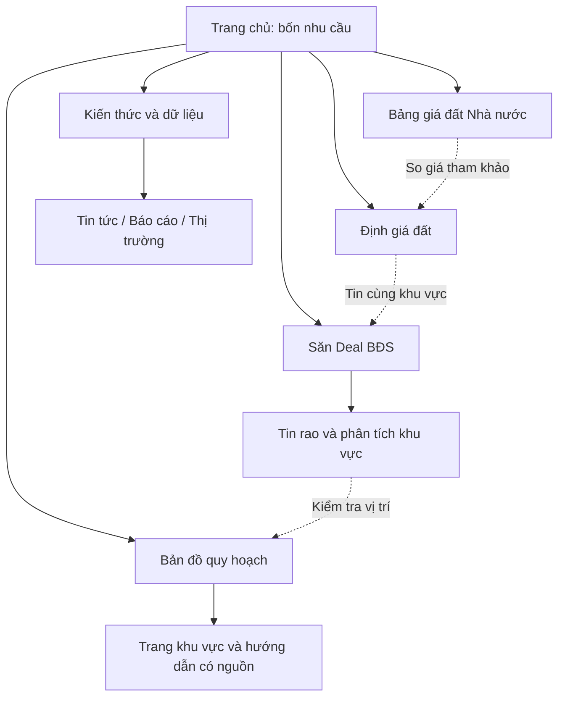

# Đề xuất tổ chức Radar BDS: Quy hoạch, Săn Deal và công cụ giá đất

Ngày khảo sát: 03/11/2026. Trạng thái: nghiên cứu và đề xuất, chưa triển khai.

## 1. Quyết định đề xuất

Tổ chức website theo việc người dùng muốn làm: **Xem quy hoạch → Săn Deal → Định giá → Tra bảng giá đất**. Quy hoạch và Săn Deal là hai trụ cột sản phẩm; hai công cụ giá đất là lối vào tìm kiếm và hỗ trợ quyết định. Tin tức/báo cáo giải thích và dẫn vào công cụ phù hợp.

Chọn mô hình kết hợp: trang chủ giúp nhận biết bốn việc chính; không gian bản đồ và danh sách deal dành tối đa diện tích cho thao tác. Nội dung SEO nằm trên các trang có chủ đề, nguồn và phạm vi riêng. Dùng chung ứng dụng Maps hiện có, không xây thêm một bản đồ song song.

Triển khai tăng dần: đầu tiên thống nhất điều hướng và làm nổi lối vào, giữ URL hiện có. Sau đó mới tách trang chủ và workspace nếu thử nghiệm cho thấy có lợi. Đây là thay đổi định hướng so với tài liệu marketing cũ chỉ tập trung funnel Săn Deal Bình Dương; cần cập nhật tài liệu đó khi triển khai phương án được chọn.

## 2. Phạm vi và chất lượng bằng chứng

- Đọc các trang công khai bằng công cụ web, đồng thời mở Chrome và quan sát giao diện đã chạy JavaScript của Guland, Meey Map, ThongTinLand và Radar BDS.
- Khảo sát desktop: trang chủ Guland và Maps; trang giới thiệu Meey Map và Maps; danh sách tin ThongTinLand và Maps; dashboard và định giá Radar. Đọc thêm trang bảng giá đất ThongTinLand và Radar qua web.
- Chrome dùng phiên hiện có: Guland đã có tài khoản, Radar là phiên admin. Không coi quyền lợi, số liệu hay hành vi trong phiên đó là bằng chứng trải nghiệm khách vãng lai.
- HTML trích xuất của ThongTinLand ít nội dung hơn giao diện trình duyệt. Đây là giới hạn công cụ quan sát, chưa chứng minh Google không lập chỉ mục được.
- Không đo traffic, thứ hạng, backlink, lượng tìm kiếm hay chuyển đổi của đối thủ. Những đánh giá “nên học/không nên học” là nhận định về kiến trúc và UX, không phải kết quả A/B test.
- Đã chạy Graphify query trước khi đối chiếu source: `navigation seo initseoheader openplanningmapfromtools`. Graph có 15.471 nodes, kết quả bị giới hạn budget; CLI cảnh báo phiên bản package cũ hơn skill. Chỉ dùng graph để định tuyến file, kiểm tra lại kết luận trong source.
- HEAD lúc đọc: `3e04650c`. Working tree sạch trước khi tạo báo cáo. Không xác minh SHA production trong nghiên cứu này.

## 3. Đối thủ: quan sát và bài học

| Website | Quan sát thực tế | Áp dụng cho Radar | Điểm cần cân nhắc |
|---|---|---|---|
| Guland | Trang chủ có lưới tiện ích, điều hướng Quy hoạch/Check giá, trang quy hoạch theo địa phương; trên tin có lối sang quy hoạch và so sánh giá. Maps có Khu vực, Địa điểm, Góc ranh, Tờ thửa. | Đưa chức năng ra rõ, nối công cụ tại đúng tin/vị trí, giữ khu vực xuyên suốt. | Nhiều mục ngang hàng và các khối dài cạnh tranh sự chú ý. Radar chỉ cần ưu tiên bốn việc chính. |
| Meey Map | Trang giới thiệu riêng với CTA Tra cứu ngay; Maps có thanh chuyển Bản đồ QH/Tin đăng/Định giá/Phân tích/Độ phủ. | Phân biệt nơi giới thiệu và nơi thao tác; có tên và đường chuyển rõ giữa các chức năng. | Không học thông điệp chung kiểu “BĐS 4.0”; Radar nên nói người dùng làm được gì và ở đâu. “Bảng giá” của Meey trong menu dẫn tới gói dịch vụ, không đồng nghĩa bảng giá đất Nhà nước. |
| ThongTinLand | Trang tin có menu Quy hoạch/Tin đăng/Bảng giá đất, URL tin chi tiết và phân trang; Maps có Khu vực/Tọa độ/Tờ thửa/Góc ranh. Bảng giá đất có bộ lọc và liên kết địa phương. | Menu theo nhu cầu, mỗi nhóm có điểm vào rõ, dữ liệu giá có thể tiếp cận từ HTML. | Khối giới thiệu trên trang tin chiếm nhiều chiều cao. Không mang khối giới thiệu đó vào workspace săn deal. |

Nguồn đối thủ:

- https://guland.vn/
- https://guland.vn/soi-quy-hoach/dong-nai — URL địa phương quan sát được trong phiên, không kiểm chứng độ phủ dữ liệu.
- https://meeymap.com/
- https://meeymap.com/tra-cuu-quy-hoach
- https://quyhoach.thongtin.land/tin-dang/
- https://quyhoach.thongtin.land/
- https://quyhoach.thongtin.land/bang-gia-dat/

## 4. Những điểm Radar cần giải quyết

1. **Hai hệ điều hướng khác nhau.** Dashboard có Săn Deal/Tin rao/Phân tích/Công cụ; trang nội dung có Thị trường/Quy hoạch/Công cụ/Báo cáo/Tin tức. Người chuyển trang phải học lại cách tìm chức năng.
2. **Tên Maps chưa nói rõ lợi ích.** “Xem trên Maps” dễ được hiểu là chỉ xem vị trí tin; Quy hoạch trên Maps trong dashboard nằm dưới Công cụ. Cần tên “Bản đồ quy hoạch” ở điều hướng cấp cao.
3. **Định giá và bảng giá đất còn nằm trong nhóm chung.** Người mới không nhìn thấy ngay sự khác nhau giữa giá tham khảo từ tin rao và bảng giá do Nhà nước ban hành.
4. **Trang chủ hiện là workspace.** Có lợi cho người quen nhưng chưa giới thiệu rõ bốn tác vụ cho người mới. Không giải quyết bằng banner lớn phủ danh sách tin.
5. **Phạm vi từng công cụ khác nhau.** Trang định giá hiện công bố Thủ Dầu Một/Bến Cát/Mỹ Phước; bảng giá hiện có trang TP.HCM. Maps không thể dùng làm bằng chứng Săn Deal/định giá đã phủ mọi địa phương.
6. **Giá rao cần được gọi đúng tên.** Cân nhắc đổi nhãn “THỰC TẾ” trên card thành “GIÁ RAO” khi giá trị hiển thị là giá rao; “Rẻ hơn X%” cần giải thích mốc so sánh là giá ước tính, không phải giá giao dịch đã chốt.

Đối chiếu source: `templates/index.html`, `templates/partials/seo_header.html`, `static/js/main/core.js`, `routes/public.py`, `config/seo_pages.py`; tài liệu Maps: `docs/maps-agent-guide.md`.

## 5. Điều hướng đề xuất

Desktop, một thứ tự thống nhất trên trang công khai và workspace:

**Bản đồ quy hoạch | Săn Deal BĐS | Định giá đất | Bảng giá đất | Kiến thức & dữ liệu**

Logo về trang chủ; đăng nhập/tài khoản nằm bên phải. Đánh dấu mục đang dùng. Tin rao là lựa chọn trong nhóm Săn Deal, không cần thêm một mục cấp một. Trong dropdown Săn Deal: Săn Deal, Tất cả tin rao, Phân tích khu vực, Cách đọc deal. Trong Kiến thức & dữ liệu: tin tức, báo cáo, hướng dẫn, thị trường theo khu vực.

Mobile, đề xuất thanh dưới: **Quy hoạch | Săn Deal | Định giá | Bảng giá | Thêm**. “Thêm” chứa kiến thức, báo cáo, tài khoản và trợ giúp. Khi mở Maps toàn màn hình, dùng điều khiển gọn và chừa vùng thao tác; tránh xếp chồng hai thanh đáy. Đây là thiết kế đề xuất, chưa kiểm tra trên thiết bị.

Footer: Công cụ / Khu vực có dữ liệu / Hướng dẫn và phương pháp / Về Radar và hỗ trợ. Liên kết HTML tới trang quan trọng, không chỉ tới sitemap XML.

## 6. Trang chủ và việc học chức năng

Trang chủ đích nên mở bằng một câu cụ thể, ví dụ:

> Xem quy hoạch, so giá và tìm bất động sản đáng kiểm tra.

Ngay dưới có bốn thẻ, mỗi thẻ gồm tên, lợi ích, phạm vi, nút hành động:

| Thẻ | Giải thích | Hành động |
|---|---|---|
| Bản đồ quy hoạch | Xem lớp quy hoạch, tìm vị trí, tra tờ/thửa nơi có dữ liệu. | Mở bản đồ |
| Săn Deal BĐS | Lọc tin có giá rao thấp hơn mức ước tính, xem lịch sử giá và cảnh báo. | Tìm deal theo khu vực |
| Định giá đất | Nhập đặc điểm lô đất, xem mức giá tham khảo và mẫu so sánh. | Định giá lô đất |
| Bảng giá đất Nhà nước | Tra cứu theo đường/khu vực trong phạm vi đang hỗ trợ. | Tra bảng giá đất |

Quy hoạch và Săn Deal nổi bật hơn hai thẻ công cụ giá. Bên dưới: minh họa ngắn hai chức năng chính, khu vực hỗ trợ từng công cụ, một số tin hoặc báo cáo có dữ liệu thực, hướng dẫn và nguồn/phương pháp. Không thêm bộ tìm kiếm chung hứa nhận mọi loại đầu vào khi hệ thống chưa xử lý được.

Người vào qua URL có filter/Maps đi thẳng vào workspace tương ứng, không bị chặn bởi trang giới thiệu. Người quay lại có nút “Tiếp tục khu vực đang xem”; URL được ưu tiên hơn lựa chọn đã lưu. Không tự chuyển trang theo cookie làm người dùng mất định hướng.

Giúp hiểu chức năng ngay tại thời điểm cần:

- Trong Maps, hướng dẫn ba bước: chọn khu vực → chọn lớp → tìm vị trí/thửa. Các chức năng nâng cao như tọa độ/góc ranh nằm trong công cụ tra cứu mở thêm.
- Trong Săn Deal, giải thích ngắn “giá rao”, “giá ước tính”, “giảm giá”, cảnh báo nguồn. Dùng ví dụ có nhãn minh họa nếu không phải số liệu thật.
- Có mục “Tôi muốn…” và hướng dẫn riêng từng nhu cầu; không ép xem tour nhiều bước hay popup ngay khi mở.
- Không bắt người dùng học hết trước khi làm việc. Đo khả năng tìm và hoàn tất một tác vụ, thay vì đo số mục họ đã đọc.

## 7. Sitemap và URL

### Cấu trúc logic đích

### Registry tối thiểu và cách chuyển tiếp

| Trang / intent | URL hiện có hoặc đề xuất | Cách xử lý |
|---|---|---|
| Trang chủ / nhận biết chức năng | `/` hiện có | Giai đoạn đầu giữ workspace; thử lối vào gọn. Chỉ chuyển thành trang chủ giới thiệu khi đã có đường vào workspace và kiểm tương thích link cũ. |
| Dùng Săn Deal | `/?tab=signals` hiện có | Giữ hoạt động cùng mọi filter hiện có. `/san-deal` chỉ là route workspace đề xuất khi tách trang chủ. |
| Đọc phương pháp Săn Deal | `/san-deal-bds` hiện có | Giữ intent hướng dẫn, tránh tạo trang khác cạnh tranh cùng intent. |
| Dùng Maps | `/?tab=all&map=1&planning=partition` hiện có | Dùng engine hiện có. `/ban-do-quy-hoach` là route workspace đề xuất về sau, không phải route đang tồn tại. |
| Đọc quy hoạch Bình Dương | `/quy-hoach-binh-duong` và các chuyên đề con | Giữ URL; đưa công cụ mở đúng lớp/khu vực lên đầu. Không biến hub này thành bản sao canvas Maps. |
| Định giá | `/dinh-gia-bds` hiện có | Giữ URL, nhãn và phạm vi rõ, kết quả trước nội dung giải thích dài. |
| Bảng giá đất | `/bang-gia-dat-tphcm` hiện có | Giữ URL, nguồn và kỳ hiệu lực. Chỉ tạo hub `/bang-gia-dat` khi thực sự có thêm bộ dữ liệu hỗ trợ. |
| Thị trường / địa phương | `/binh-duong`, `/binh-duong/<location>` hiện có | Dẫn tới deal và công cụ đúng khu vực. |
| Tin tức / báo cáo | `/tin-tuc`, `/bao-cao` hiện có | Giữ URL và bài con, phân nhóm theo intent và liên kết về công cụ. |
| Hướng dẫn sử dụng | Nhóm đề xuất; chưa chốt slug | Trước hết tận dụng các trang hướng dẫn hiện có; chỉ bổ sung khoảng trống thực sự. |

Không có lý do đổi hàng loạt slug đang có chỉ để URL nhìn đồng bộ. Route workspace mới chỉ đặt khi cần địa chỉ độc lập, không kỳ vọng tên URL tự tạo thứ hạng.

## 8. SEO gắn với dữ liệu thực

- Mỗi intent có một trang chính: tra quy hoạch, tìm deal, định giá, bảng giá đất. Trang thao tác và trang hướng dẫn chỉ cùng tồn tại khi phục vụ nhu cầu khác nhau rõ ràng.
- Trang địa phương có nội dung HTML hữu ích: dữ liệu đang hỗ trợ, nguồn/ngày cập nhật, lớp bản đồ có sẵn, giới hạn, hướng dẫn và nút mở đúng khu vực. Không chỉ thay tên tỉnh trên cùng một đoạn văn.
- Các liên kết điều hướng quan trọng dùng `<a href>` thật. Google nêu rõ nút chỉ gọi JavaScript không phải cách đáng tin để khám phá URL: https://developers.google.com/search/docs/crawling-indexing/links-crawlable
- Không đưa mọi tổ hợp filter, zoom, tọa độ hay lớp bản đồ vào sitemap. Google cảnh báo bộ lọc có thể tạo không gian URL rất lớn và lãng phí crawl: https://developers.google.com/crawling/docs/faceted-navigation
- Lập chính sách crawl/index theo loại URL trước khi sửa robots: trang SEO có canonical chính nó; biến thể trùng nội dung xử lý canonical phù hợp; trang không muốn index dùng noindex khi Google còn crawl được. Không chặn robots đồng thời rồi kỳ vọng Google đọc noindex. Canonical là tín hiệu, không phải lệnh bảo đảm.
- Giữ `#map=...` để chia sẻ trạng thái ứng dụng; không coi từng fragment là một landing page SEO.
- Khi bắt buộc đổi URL: mapping 301 một bước, giữ filter và vị trí/lớp Maps, sửa link nội bộ/canonical/sitemap, kiểm link cũ từ bài viết, social và report.
- Dữ liệu địa danh cũ/mới cần giải thích tên và phạm vi nhất quán. Không nhân đôi trang giống nhau chỉ vì hai tên hành chính.
- Ưu tiên trang có dữ liệu đã xác minh và nhu cầu có bằng chứng; 13 thị trường Maps là phạm vi ưu tiên sản phẩm, không phải bằng chứng volume SEO hay độ phủ thửa toàn quốc.

## 9. Nối các công cụ thành một hành trình

1. **Từ deal:** xem giá rao/ước tính → mở quy hoạch tại vị trí tin → trở lại đúng tin và bộ lọc. Vị trí chỉ ước lượng phải ghi rõ, không tự gán thành thửa chính xác.
2. **Từ quy hoạch:** chọn khu vực → xem lớp/nguồn → xem tin đang rao gần đó nếu có dữ liệu → lọc deal. Nếu chưa có tin thì nói rõ, không đưa kết quả Bình Dương cho khu vực khác.
3. **Từ định giá:** xem mức tham khảo/mẫu so sánh → xem tin phù hợp cùng địa bàn → mở quy hoạch. Chỉ truyền trường có độ tin cậy đủ dùng, cho sửa lại trước khi tính.
4. **Từ bảng giá:** xem giá theo văn bản → đọc khác biệt với giá thị trường → định giá hoặc xem tin cùng khu vực nếu công cụ có hỗ trợ. Không suy giá thị trường bằng một hệ số tùy ý từ bảng giá.

Giữ khu vực, listing ID và loại tài sản khi chuyển công cụ; không tự xác nhận đường/tờ/thửa từ dữ liệu thiếu. Gợi ý bước tiếp theo theo bối cảnh, không luôn đẩy mọi người vào Săn Deal khi họ chỉ cần tra cứu quy hoạch.

## 10. Thứ tự thực hiện và tiêu chí kiểm chứng

**Đợt 1 — dễ tìm:** thống nhất tên/thứ tự menu, đưa Quy hoạch ra cấp một, hiện trực tiếp Định giá/Bảng giá, thay “Mở dashboard” bằng hành động rõ. Dùng URL hiện có, bổ sung hướng dẫn ngắn tại chỗ. Kiểm trên khách/admin và desktop/mobile; không chèn banner cao vào feed.

**Đợt 2 — dễ hiểu và đi tiếp:** bốn lối vào trên trang chủ phù hợp bố cục, trang giải thích theo tác vụ, CTA giữ khu vực giữa Maps/deal/định giá/bảng giá. Nếu cần tách `/` khỏi workspace, thực hiện mapping link cũ trước và triển khai riêng có rollback. Không chạy thêm feed/count chỉ để nuôi các khối quảng bá.

**Đợt 3 — SEO theo cụm:** nâng chất trang hiện có, thêm trang khu vực đủ nguồn/nội dung, breadcrumb, liên kết liên quan, sitemap và chính sách URL. Chọn thứ tự bằng GSC và dữ liệu sử dụng thực khi có, chưa tự giả định công cụ nào có volume cao nhất.

Kiểm chứng đề xuất:

- Bài thử với 5 người mới: tìm đường xem quy hoạch, tìm deal theo ngân sách, giải thích hai loại giá, chuyển từ tin sang Maps. Mục tiêu thí điểm: ít nhất 4/5 chọn đúng lối vào không cần hướng dẫn; đây là mục tiêu đặt ra, chưa phải kết quả.
- Đo từ lượt vào tới thao tác có ích: mở đúng vùng/lớp Maps hoặc tra thành công; mở deal sau filter; định giá thành công; tìm được dòng bảng giá. Tách lỗi dữ liệu khỏi lỗi điều hướng.
- Đo chuyển công cụ giữ bối cảnh và quay lại, cùng hành động liên hệ theo cơ chế hiện có. Tận dụng event `cta_clicked` và các event sẵn có trước khi thêm tên mới; thông số không chứa PII hay tọa độ riêng tư.
- Theo dõi GSC theo nhóm landing page và cùng cửa sổ thời gian đủ dữ liệu; không nhận biến động thứ hạng là tác động chắc chắn của việc sửa menu.
- Khi triển khai phải kiểm quyền redaction, deep link/Back, thứ tự signals trước counts, lazy-load Maps, cache khách so với phiên riêng tư và phạm vi thực của từng nguồn. Nghiên cứu này chưa thực hiện các bài kiểm đó.

## 11. Các giới hạn chưa kiểm tra

Chưa audit SEO kỹ thuật toàn site, Search Console/GA4, responsive trên điện thoại, hiệu năng/load, hay quyền lợi gói trả phí đối thủ. Chưa kiểm tính đúng của dữ liệu quy hoạch/định giá đối thủ. Chưa sửa code, commit hay deploy; file này chỉ là bản nghiên cứu để chọn cấu trúc.
